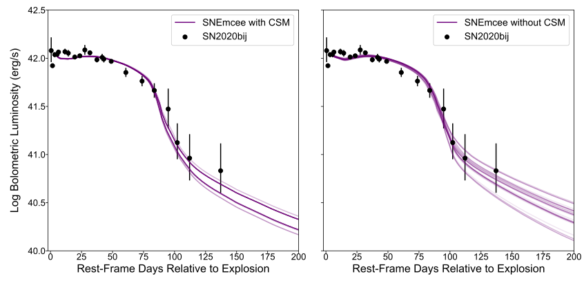

<h1 align="center">SNEmcee</h1>

<div align="center">
  
  
  
</div>

<div align="center">
  SNEmcee is a Python tool that uses Markov Chain Monte Carlo (MCMC) to fit numerical progenitor and explosion models to Type IIP supernova light curves and velocities.
</div>

## Example results

<div align="center">
  
</div>

<div align="center">
  <em>SNEmcee fits to the bolometric light curve of SN 2020bij with (left) and without (right) CSM interaction, from <a href="https://doi.org/10.3847/1538-4357/ae8772">Mohsen-Tanev et al. (2026)</a>.</em>
</div>

<div align="center">
  <sub>Source: SN 2020bij and a Possible Slow-rise High-velocity Subclass of Type IIP Supernovae, The Astrophysical Journal (2026).
  <a href="https://doi.org/10.3847/1538-4357/ae8772">DOI</a> |
  <a href="https://creativecommons.org/licenses/by/4.0/">CC BY 4.0</a>.</sub>
</div>

## Contents
- [Installation](#installation)
- [Dependencies](#dependencies)
- [Input supernova data](#input-supernova-data)
- [SNEC model grid](#snec-model-grid)
- [Fitting parameters](#fitting-parameters)
- [Running SNEmcee](#running-snemcee)
- [CSM fitting options](#csm-fitting-options)
- [SNEmcee outputs](#snemcee-outputs)
- [Running script for comparison plots](#running-script-for-comparison-plots)
- [Plotting outputs](#plotting-outputs)
- [Citation](#citation)

## Installation

Clone the SNEmcee repository:

```bash
git clone https://github.com/sondosmohsen/SNemcee.git
cd SNemcee
```

## Dependencies
SNEmcee requires the following Python libraries:

`corner`, `emcee`, `pandas`, `numpy`, `scipy`, `matplotlib`

Install the required dependencies using:

```bash
pip install -r requirements.txt
```

## Input supernova data

Supernova data files (observations) should be stored in the `SN_data` directory, with the following names:

- `<SN_name>_veloc` - Fe II 5169 velocity measurements (km/s).
- `<SN_name>_mag` - Multi-band photometric measurements.
- `<SN_name>_lum` - Bolometric luminosity measurements (erg/s).

See the example files for SN2017eaw in `SN_data` for the expected file formats.

In addition, the file `distances.csv` should be stored in `SN_data` and contain the following columns:

- `SN_name` - Supernova name.
- `distance` - Distance in Mpc.
- `distance_err` - Distance uncertainty in Mpc.

### Example directory structure

```text
SN_data/
├── distances.csv
├── SN2017eaw_lum
├── SN2017eaw_mag
└── SN2017eaw_veloc
```

## SNEC model grid

SNEmcee uses a pre-computed grid of 2,469 hydrodynamical explosion models calculated with SNEC, using KEPLER red supergiant progenitors with and without circumstellar material (CSM).

### Download and extraction

[**Download the SNEC model grid (2,469 models)**](https://drive.google.com/file/d/1-7ki0ADkq2_Y8ffyzWMT42_VuvXQK69p/view?usp=sharing)

Place the downloaded archive in the main SNEmcee directory and extract it using:

```bash
tar -xf SNEC_models.tar.gz
```

The result should be the directory `SNEmcee/SNEC_models`, which contains 2,469 subdirectories with names like:

```text
M9.0_Ni0.001_E0.1_Mix2.0_R1000_K10
```

Each model subdirectory contains the predicted bolometric light curve, multi-band magnitudes, Fe II 5169 velocities, and effective temperature evolution.

## Fitting parameters

SNEmcee fits eight parameters: six parameters defining the SNEC model grid and two additional fitting parameters (`S` and `t`).

| Parameter | Description | Grid values | Units |
| --- | --- | --- | --- |
| `Mzams` | Progenitor ZAMS mass | 9, 10, 11, 13, 15, 17 | Solar masses |
| `Ni` | Nickel-56 mass | 0.001, 0.02, 0.07, 0.12 | Solar masses |
| `E` | Explosion energy | 0.1, 0.3, 0.5, 0.9, 1.3, 1.7 | 10<sup>51</sup> erg |
| `R` | CSM thickness | 0, 500, 1000, 2000 | Solar radii |
| `K` | CSM density parameter | 0, 10, 30, 60 | 10<sup>17</sup> g/cm |
| `Mix` | Nickel-56 mixing | 2, 8 | Solar masses |
| `S` | Luminosity scaling factor | - | Dimensionless |
| `t` | Explosion time shift | - | Days |

The parameter `R` in the code represents the CSM thickness (the outer CSM radius minus the progenitor radius).

The scaling factor `S` accounts for uncertainties in the distance estimate, and `t` accounts for uncertainties in the assumed explosion time.

SNEmcee interpolates between the discrete grid points to continuously explore the parameter space.

For fits without CSM, `R` and `K` are fixed to zero.

## Running SNEmcee

To run SNEmcee on your SN of choice, use the following command:

```bash
python3 run_mcmc_snec_for_all_SNe.py \
    -S <SN name> \
    -t <fitting_type> \
    -s <number of steps> \
    -b <burn-in steps> \
    -w <number of walkers> \
    -o <output directory> \
    -c <csm> \
    -n <normalization> \
    -l <luminosity threshold> \
    -p <nonuniform priors>
```

### Command-line arguments

| Argument | Description | Options | Default |
| --- | --- | --- | --- |
| `-S` | SN name | e.g., `SN2017eaw` | Required |
| `-t` | Fitting type | `lum`, `veloc`, `mag`, `lum-veloc`, `mag-veloc`, `lum-mag`, `lum-veloc-mag` | `lum` |
| `-s` | Number of steps | Integer | `500` |
| `-b` | Burn-in steps | Integer | `300` |
| `-w` | Number of walkers | Integer | `30` |
| `-o` | Output directory name | Directory name | `output_<current time>` |
| `-c` | CSM fitting mode | `with`, `without`, `twostep`, `twostep-carryover` | `with` |
| `-n` | Normalization | `True`, `False` | `False` |
| `-l` | Luminosity threshold | `True`, `False` | `False` |
| `-p` | Nonuniform priors | `True` to enable a Gaussian prior on `S`; omit to disable | `None` |

When normalization is enabled, each log-likelihood contribution is divided by the number of data points in the corresponding dataset.

The temperature threshold (10<sup>3.5</sup> K) is always applied to velocity and magnitude fits, and is optionally applied to bolometric luminosity fits using the `-l` argument.

### Example MCMC run

To fit the bolometric light curve and Fe II 5169 velocities of SN2017eaw with CSM, using 1,000 steps, 400 burn-in steps and 50 walkers, run:

```bash
python3 run_mcmc_snec_for_all_SNe.py \
    -S SN2017eaw \
    -t lum-veloc \
    -s 1000 \
    -b 400 \
    -w 50 \
    -o example \
    -c with
```

## CSM fitting options

SNEmcee supports four CSM fitting modes, specified using the `-c` argument:

### With CSM (`with`)

All eight parameters are fitted simultaneously, including the CSM parameters `R` and `K`.

### Without CSM (`without`)

Only six parameters are fitted, with `R` and `K` fixed to zero.

### Two-step fitting (`twostep`)

The fitting is performed in two stages. In the first stage, the models are fitted without CSM. In the second stage, CSM is included, using the final walker positions from the first stage as initial guesses for the six non-CSM parameters. The CSM parameters are initialized randomly within their allowed ranges.

### Two-step fitting with prior carryover (`twostep-carryover`)

Similar to `twostep`, but the posterior distributions of the six non-CSM parameters obtained after burn-in in the first stage are approximated by degree-12 polynomial functions and used as priors in the second stage.

**Note:** For both two-stage fitting modes, the final sampler contains only the results of the second stage. The specified number of MCMC steps is applied to each stage separately.

## SNEmcee outputs

Output files will be stored in:

```text
mcmc_results/<output directory>/<number of steps>step/<SN_name>_<fitting_type>_csm-<csm>_normalized<normalization>_TreshLum<luminosity_threshold>/
```

Output files will include:

### `flat_sampler.csv`

MCMC sampler output table - a 2D table, where columns are the parameters, and rows are walkers and steps (including burn-in steps).

The columns are ordered as follows:

```text
Mzams, Ni, E, R, K, Mix, S, t
```

The file does not contain column headers.

For fits without CSM, `R` and `K` are set to zero.

For two-stage fits, only the samples from the second stage are saved.

### `final_results.csv`

Summary statistics for each parameter calculated from all walkers at the final MCMC step: mean and lower and upper uncertainties derived from the 16th and 84th percentiles.

### `run_parameters.csv`

Record of the input arguments used in that run.

### `log_likelihoods.csv`

Log-posterior values from the MCMC sampler, including burn-in steps and excluding non-finite values. For two-stage fits, only the values from the second stage are saved.

For `twostep-carryover` fits, figures showing the first-stage parameter distributions and their polynomial approximations are also saved.

## Running script for comparison plots

After running `run_mcmc_snec_for_all_SNe.py`, you can use `plot_snec_fits_wrapper.py` to plot paper-ready figures - for example, to compare the effect of different likelihood functions (different fitting schemes), or the inclusion of CSM, on the posterior distributions:

```bash
python3 plot_snec_fits_wrapper.py \
    -S <SN name> \
    -s <number of steps> \
    -f <figure_type> \
    -o <output directory> \
    -t <fitting type> \
    -c <csm> \
    -n <normalization> \
    -l <luminosity threshold>
```

### Command-line arguments

| Argument | Description | Options | Default |
| --- | --- | --- | --- |
| `-S` | SN name | e.g., `SN2017eaw` | Required |
| `-s` | Number of steps | Integer | `500` |
| `-f` | Figure type | `lum`, `veloc`, `mag` (or any combination separated by `-`), `corner`, `walkers`, or comparison plots listed below | `lum` |
| `-o` | Output directory name | Directory name | `output_<current time>` |
| `-t` | Fitting type | `lum`, `veloc`, `mag`, `lum-veloc`, `mag-veloc`, `lum-mag`, `lum-veloc-mag` | `lum` |
| `-c` | CSM fitting mode | `with`, `without`, `twostep`, `twostep-carryover` | `without` |
| `-n` | Normalization | `True`, `False` | `False` |
| `-l` | Luminosity threshold | `True`, `False` | `False` |

### Figure types

| Figure type | Description |
| --- | --- |
| `lum` | Bolometric light curve fit |
| `veloc` | Fe II 5169 velocity fit |
| `mag` | Multi-band magnitude fits |
| `corner` | Corner plot of the posterior distributions |
| `walkers` | Chain plots for each parameter |

### Comparison plots

- `csm_comparison`
- `lum-mag-veloc_comparison`
- `lum-mag-veloc-Tthresh_comparison`
- `lum-veloc-normalized_comparison`
- `lum-veloc-twostep_comparison`
- `martinez_comparison`

The fitting settings should match those used in the original MCMC run.

The required MCMC runs must be completed before generating comparison plots.

The `martinez_comparison` option also requires additional model files from Martinez et al. (2020).

The `martinez_comparison` option expects MCMC results generated with normalization and the luminosity threshold disabled.

### Example plotting command

```bash
python3 plot_snec_fits_wrapper.py \
    -S SN2017eaw \
    -s 1000 \
    -f lum-veloc \
    -o example \
    -t lum-veloc \
    -c with
```

## Plotting outputs

Output files will be stored in:

```text
figures/<output directory>/<number of steps>step/
```

The Martinez comparison plots are stored in:

```text
figures/<output directory>/
```

Output files will include summary figures, depending on the selected figure type:

- Fits of models to the input observation data for that SN.
- Comparison of model fits for each run-type compared, including the input observation data for that SN.
- Corner plot of posterior distributions for each parameter.
- Comparison corner plot with the posterior distributions for each run type overlaid on one another.
- Chain plots for each parameter, with the burn-in region indicated.

## Citation

If you use SNEmcee in your research, please cite our accompanying paper:

Mohsen-Tanev, S., Shitrit, N., Bracha, S., & Arcavi, I.

**SNEmcee: MCMC Fitting of Numerical Progenitor and Explosion Models to Type IIP Supernova Light Curves and Velocities.**
